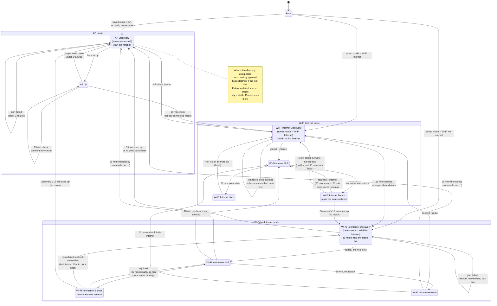

# M20 network safety

> **If the handheld controller disconnects after ~15 min, this is probably why.** How the controller connects isn't
> confirmed yet. If it isn't seen as a hotspot station, the 15 min AP check finds "nobody" and switches to Wi-Fi.
> Fix: `sudo systemctl stop network-safety` (the hotspot comes back), then raise `apCheckMinutes` in config.json.

Runs on **AOS** (the board with the Wi-Fi radio, 10.21.31.103). AOS has one radio, `wlan0`, which can be either
the factory hotspot (AP) or a client on a Wi-Fi network, never both. This service picks between them so there is
always a way back into the dog. Same diagram, rendered: https://claude.ai/artifact/39Ye3L3YTyPbkcLMiuDjq8

## Files

| Path (on AOS) | What |
|---|---|
| `~/readme/network_safety.md` | this file |
| `/usr/local/libexec/m20-network-safety` | the whole tool, compiled (`deno compile`, no code cache): needs no Deno, so no Deno install or update can break it. Source: `m20tool/board_files/aos/network_safety_main.js` in github.com/jeff-hykin/dim-m20-dash |
| `~/readme/network_safety/config.json` | settings plus the saved mode; written by the tool |
| `/etc/systemd/system/network-safety.service` | the service |
| `host_start.sh` (vendor) | its last line, which ran the vendor's `loop_start_ap.sh`, is commented out on install |

## What it does

Three modes: AP, Wi-Fi Internet and Wi-Fi No Internet. Each Wi-Fi mode goes Discovery → Soft → Hard.
Only two things are stable: being on the internet, or someone being connected. Everything else is on a timer.

- **Boot:** resumes the Discovery of the mode saved in `config.json` (missing, corrupt or unreadable → AP).
  Entering any Discovery (AP Discovery included) saves its mode.
- **AP:** every 15 min it checks whether anyone is using the dog: a station on the hotspot (phone,
  controller app, laptop) or an inbound TCP session that arrived over the hotspot or Tailscale (`countedInterfaces`).
  Anything wired never counts: the other boards on the internal switch, or a laptop on a direct Ethernet cable.
  Nobody → Wi-Fi Internet Discovery. It errs towards "nobody": a missed user can still get back in within the next
  15 min window. 3 hotspot failures (failed starts or drops; a stable 15 min clears the count) → Wi-Fi Internet
  Discovery, so a broken or flapping hotspot alternates with Wi-Fi tries instead of looping.
- **Discovery (15 min):** takes the hotspot down, scans both bands, and tries saved networks in range first, then
  open ones, strongest first. A join must stay up 60 s; Wi-Fi Internet also needs internet (Tailscale online /
  `tailscale ping`). A network that fails is marked bad for the rest of this Discovery. Success → Soft. Out of
  time, or no good candidates left → the next mode down: Wi-Fi Internet → Wi-Fi No Internet → AP.
- **Soft:** 30 min without trouble → Hard. Trouble (link lost, or for Wi-Fi Internet a failed 15 min internet
  check) → **Bumps**, one rejoin of the same network: success → Soft (30 min restarts); failure → that network is
  marked bad and it goes back to the same Discovery, keeping its bad list and its 15 min clock. Soft keeps burning
  its Discovery's 15 min: trouble after they're used up skips the rejoin and goes to the next mode down, so a flaky
  network can't hold it in Soft ↔ Bumps forever.
- **Hard:** trouble → Wi-Fi Internet Discovery, fresh (bad list cleared, new 15 min).
- **Wi-Fi No Internet** Soft/Hard still check internet every 15 min; if it shows up → Wi-Fi Internet Soft (new
  15 min clock). No inbound session (ssh, ...) over wlan0 for 15 min (`noInternetIdleMinutes`) → AP.
- **Any failure lands in AP:** an unexpected error inside the loop starts the hotspot. If the process dies or hangs
  (systemd watchdog, 15 min; the loop pings it every pass), `ExecStopPost` starts the hotspot unless it's already up,
  and `Restart=always` (no start limit, every 30 s) brings the tool back. A missing binary lands the same way.

## System commands it runs

`nmcli` (state, scan, join, AP down), `iw dev wlan0 station dump` (who is on the hotspot), `tailscale status` /
`tailscale ping` (internet), and the vendor's `/opt/robot/scripts/board_resources/wifi/ap_start.sh start 5G`
(hotspot up the stock way). Inbound connections are read from `/proc/net/tcp`.

## Changing it

- **Timers and limits** are in `config.json` (`apCheckMinutes`, `discoveryMinutes`, `softToHardMinutes`, `noInternetIdleMinutes`,
  `joinHoldSeconds`, `onlineCheckSeconds`, `allowOpenNetworks`, `tailscalePingPeers`, ...). Edit, then `sudo systemctl restart network-safety` (this restarts the hotspot: see below).
- **Add a Wi-Fi network:** `sudo nmcli connection add type wifi ifname wlan0 con-name <name> ssid <ssid>
  wifi-sec.key-mgmt wpa-psk wifi-sec.psk <password> connection.autoconnect no`. Saved networks must have
  autoconnect off, so NetworkManager never fights the hotspot on its own.
- **See what it's doing:** `NETWORK_SAFETY_DIR=~/readme/network_safety /usr/local/libexec/m20-network-safety status`,
  the same with `dry-run` (every check, changes nothing; works as any user), `journalctl -u network-safety -f`.
- **Stop it:** `sudo systemctl disable --now network-safety` (leaves the hotspot up). To hand the radio back to the
  vendor entirely, also restore `host_start.sh` from its `.orig-before-network-safety` backup.

## Install

`m20tool setup` (github.com/jeff-hykin/dim-m20-dash, `m20tool/`) does all of it, idempotently:

1. The compiled tool to `/usr/local/libexec/m20-network-safety` (when its sha256 isn't this release's), this file to
   `~/readme/`, `network-safety.service` to `/etc/systemd/system/` (it sets `NETWORK_SAFETY_DIR` to
   `~/readme/network_safety`, where `config.json` stays).
2. Stop the vendor's hotspot babysitter: in `/opt/robot/scripts/board_resources/wifi/host_start.sh` (run by
   `start.service`), comment out the last line, `/opt/robot/scripts/wifi/loop_start_ap.sh`, keeping a backup
   (`host_start.sh.orig-before-network-safety`). Don't disable `start.service`: it also starts PTP time sync and eth2.
   Boot still brings the hotspot up; this tool restarts it from then on. Also `rm /etc/m20-hotspot-off` and restore
   `ap_start.sh` from `ap_start.sh.orig-before-hotspot-flag` (the flag guard isn't needed any more).
3. Turn autoconnect off on saved Wi-Fi profiles; disable the older `m20-wifi-deadman.service` (they would fight).
4. `systemctl enable network-safety`, and start it only if it isn't running: setup never restarts it (a restart brings
   the hotspot up), so a running older version switches to the new one at its next restart (crash, watchdog, boot).
   Older installs ran `~/readme/network_safety/main.js` with `/usr/local/bin/deno`; setup removes that `main.js`.

## Nuances

- **The vendor's hotspot babysitter is off.** The factory `loop_start_ap.sh` turns the hotspot back on whenever the
  radio looks idle, a simpler version of this tool's AP fallback that would undo every Wi-Fi join. Install comments
  out the one line in `host_start.sh` that launches it. `start.service` itself stays on, because it also starts PTP
  time sync (`ptp103.sh`) and eth2. Boot still brings the hotspot up, and this tool restarts it after that.
  Uninstalling this tool means restoring `host_start.sh` from `host_start.sh.orig-before-network-safety`, or the
  hotspot won't come back on its own after a radio hiccup.

## Risks

- `systemctl restart network-safety` (or a crash) puts the hotspot up, so a remote session over Wi-Fi drops until
  the next 15 min check finds nobody on the hotspot and searches again.
- Joining open networks exposes ssh (password `'`) to whoever else is on them; `allowOpenNetworks` turns it off.
- (Medium) How the handheld controller connects isn't confirmed. If it uses the hotspot it shows up as a station and
  the hotspot stays; if it uses another path, a switch to Wi-Fi could cut it mid-use. See the note at the top.
- Without Tailscale logged in on AOS, every network counts as "no internet" and the dog alternates AP and Wi-Fi
  every 15 min.
